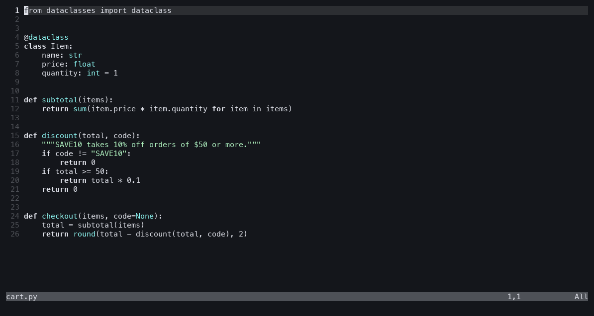

# Tandem

Work with Claude Code or Codex inside Neovim, Vim, or MacVim. The agent runs in
a split beside your code and sees what you see: it reads your unsaved buffers,
opens files, highlights code with notes, and shows Git comparisons.



- `:Claude` or `:Codex` to work through a task together.
- `:ClaudeTour` or `:CodexTour` for a guided walkthrough, one stop at a time.

Tandem never writes your buffers. There is nothing else to install: no server,
Python, or Node package.

## Requirements

- Neovim 0.11+, or Vim or MacVim 9.1+ with `+clientserver`, `+terminal`, and
  `+textprop`. Terminal Vim also needs a remote transport, such as Vim 9.2's
  `+socketserver`.
- [Claude Code](https://code.claude.com/docs/en/cli-reference) or the
  [Codex CLI](https://learn.chatgpt.com/docs/cli/reference), signed in.
- Bash and Git, on macOS or Linux.

## Install

[lazy.nvim](https://lazy.folke.io):

```lua
{ "stevekrenzel/tandem" }
```

[vim-plug](https://github.com/junegunn/vim-plug):

```vim
Plug 'stevekrenzel/tandem'
```

Native packages:

```sh
git clone https://github.com/stevekrenzel/tandem ~/.local/share/nvim/site/pack/tandem/start/tandem  # Neovim
git clone https://github.com/stevekrenzel/tandem ~/.vim/pack/tandem/start/tandem                    # Vim
```

Then run `:helptags ALL` for `:help tandem`. In Neovim, `:checkhealth tandem`
checks your setup. There's no need to lazy-load: Tandem defines its commands at
startup and loads everything else on first use.

## Usage

Start from the code you want to work on:

```vim
:Claude Help me fix this failing test
:Codex Explain this function and suggest a simpler version
:ClaudeTour Walk me through this branch's changes
:'<,'>Claude Why does this loop allocate?
```

| Command | What it does |
| --- | --- |
| `:Claude [prompt]`, `:Codex [prompt]` | Start an agent beside the current code window. |
| `:ClaudeTour [topic]`, `:CodexTour [topic]` | Start a guided walkthrough. Say "next" or ask questions at each stop. |
| `:TandemClear` | Remove all highlights and comparison panes. |

- Without a prompt, the agent looks at your code window and asks what you want.
- With selected lines, the agent is told which lines you mean.
- Run the command again to return to the agent. A prompt is typed into its
  input, ready to send. `:Claude!` and `:Codex!` start over with a fresh agent.
- Hide the agent with `:q` and bring it back with the same command. To leave
  the agent's terminal, press `<C-\><C-n>`, then `<C-w>h` to reach your code.
- Each code window has its own agent, so you can run several at once. If you
  close an agent's code window, run the command again to give it a new one.
- When the agent exits, its highlights disappear. After a clean exit, its pane
  closes too.

## What the agent can do

- Read your buffers, including unsaved changes.
- Open files in your code window and highlight lines with short notes.
- Compare the current file with `HEAD` or any Git revision.
- Edit files with its usual tools. Tandem reloads buffers that have no unsaved
  changes, so you see the edits.

It never writes, saves, or discards your buffers, and it won't move your code
window while you're typing in it. Highlights and notes never change the file.

## Permissions

The agent drives your editor by running a small helper, `tandem`, in its shell.
Tandem keeps your agent's permission settings and adds only what the helper
needs:

- **Claude Code:** Tandem passes `--settings` with an allow rule for
  `Bash(tandem *)`, plus access to the editor's socket in case Claude's sandbox
  is on. These add to your own settings, and your deny and ask rules still win.
- **Codex:** a session can't be granted the helper alone, so Tandem adds
  nothing. If Codex runs sandboxed, as it does by default, it asks to run its
  first `tandem` command outside the sandbox. Approve it with "don't ask again",
  or add this line to `~/.codex/rules/default.rules`:

  ```
  prefix_rule(pattern=["tandem"], decision="allow")
  ```

  The rule lets only commands that start with `tandem` run outside the sandbox.

## Configuration

Tandem works without configuration.

| Option | Default | Meaning |
| --- | --- | --- |
| `g:tandem_claude_cmd` | `['claude']` | Command that starts Claude Code. |
| `g:tandem_codex_cmd` | `['codex', '--no-daemon']` | Command that starts Codex. `--no-daemon` runs Codex's commands in this session, where they can reach the editor. |
| `g:tandem_width` | `0.42` | Agent pane width, as a fraction of the screen or a number of columns. |

```vim
let g:tandem_claude_cmd = ['claude', '--model', 'opus']
let g:tandem_width = 90
```

Neovim also accepts Lua, including lazy.nvim's `opts`:

```lua
require("tandem").setup({ claude_cmd = { "claude", "--model", "opus" }, width = 90 })
```

A command can be a list or a string; use a list if an argument contains spaces.
Tandem appends its own arguments and the prompt, so a wrapper script must pass
its arguments on to the agent. If a MacVim started from the Dock can't find the
agent, use its full path.

Highlights use `TandemRange` and `TandemNote`, linked to `Visual` and `Special`.

## Troubleshooting

- **The command doesn't exist.** Restart the editor, or run `:packadd tandem`
  for an `opt` package.
- **The executable was not found.** Install the agent and sign in, or set
  `g:tandem_claude_cmd` or `g:tandem_codex_cmd` to its full path.
- **The agent can't reach the editor.** For Codex, allow the `tandem` command as
  described under [Permissions](#permissions). Otherwise run `:Claude!` or
  `:Codex!` from a code window. MacVim's server needs its GUI; terminal Vim
  needs a remote transport such as `+socketserver`.
- **This tab already has a diff open.** Close that comparison or use another
  tab. Vim and Neovim share one diff per tab.
- **Codex rejects `--no-daemon`.** Update Codex, or set
  `g:tandem_codex_cmd = ['codex']`.

## How it works

`:Claude` and `:Codex` open the agent in a terminal split, put the `tandem`
helper from `skills/tandem/scripts` on its `PATH`, and give it the instructions
in `skills/tandem/SKILL.md`. The helper uses the editor's built-in remote
client:

```sh
tandem state                                    # code window, cursor, open buffers, unsaved changes
tandem read [FILE] [--start N] [--end N]
tandem show FILE [--start N] [--end N] [--note TEXT]
tandem highlight --start N [--end N] [--note TEXT]
tandem diff [FILE] [--base REV]
tandem clear
```

It prints JSON and exits nonzero on errors. To use it outside an agent pane,
pass `--server` (from `:echo v:servername`) and `--window` (from
`:echo win_getid()`), plus `--editor vim` for Vim or `--editor macvim` for
MacVim.

## Development

```sh
python3 -m unittest discover -s tests -v
shellcheck skills/tandem/scripts/tandem
```

The tests drive real headless editors in temporary Git repositories. Vim tests
need terminal Vim with `+socketserver` (`VIM_TEST_BINARY=/path/to/vim`), and
MacVim GUI tests are opt-in (`MACVIM_GUI_TESTS=1`). The Codex permission checks
run when Codex is installed. `TANDEM_AGENT_E2E=1` also runs Claude Code and
Codex against a live editor with your signed-in CLIs, for a fraction of a cent.

## License

MIT
